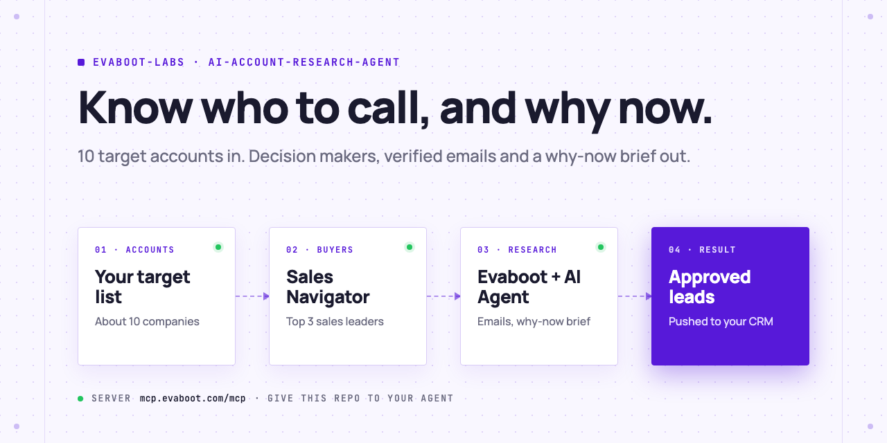
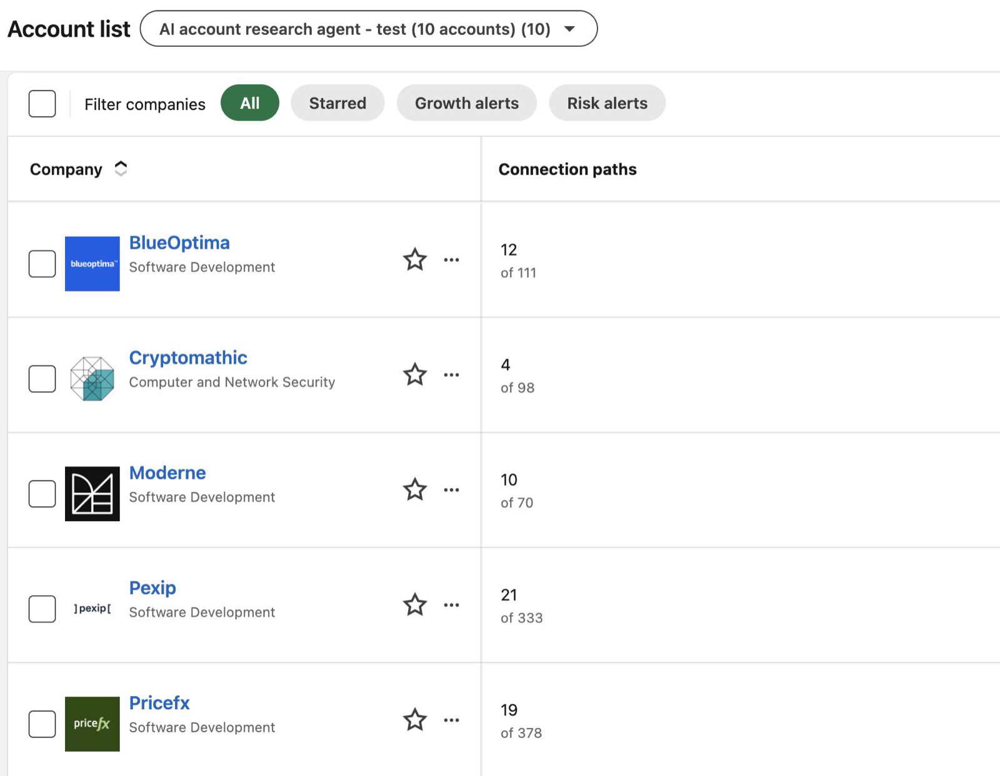
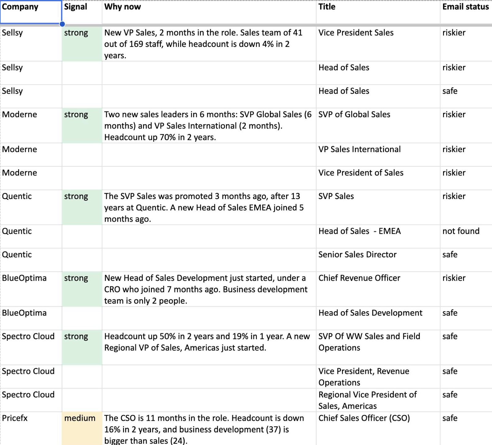
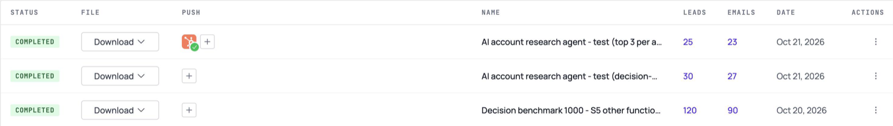

<picture>
  <source media="(prefers-color-scheme: dark)" srcset=".github/assets/banner-dark.png">
  
</picture>

# AI account research agent

Give your AI Agent 10 target companies. It finds the sales leaders, gets their verified emails, and tells you why each account might buy now, before anything reaches your CRM.

[](AGENTS.md)
[](https://evaboot.com/mcp)
[](LICENSE)

## Set it up in one prompt

Paste this into Claude Code, Codex or Cursor:

```text
Clone https://github.com/evaboot-labs/ai-account-research-agent, read AGENTS.md and follow the skill. Then research these accounts for me: <your 10 companies>.
```

<details>
<summary>Or install the skill</summary>

Claude Code:

```text
/plugin marketplace add evaboot-labs/ai-account-research-agent
/plugin install ai-account-research-agent@evaboot-labs-ai-account-research-agent
```

Codex, Cursor and other agents:

```bash
npx skills add evaboot-labs/ai-account-research-agent
```

</details>

## How it works

**1. Find the buyers, free.** The agent saves your companies as a Sales Navigator account list, previews their sales leaders at no cost, and picks the 3 most senior per company.



**2. Export only those people.** Evaboot returns verified emails and the company data. The agent writes a why-now brief per company from that data only, and grades it strong, medium or weak.



**3. You approve, it pushes.** Nothing reaches your CRM until you say yes in the sheet. Then the leads land in HubSpot, Pipedrive, Attio or any CRM connected to Evaboot.



## What you need

- An [Evaboot account](https://dash.evaboot.com/accounts/signup/?last_click_origin=ai-account-research-agent-repo) and a Sales Navigator seat.
- An AI Agent that can use an MCP server: Claude Code, Codex, Cursor, or Claude and ChatGPT on the web.
- Python 3.9+, with no packages to install.
- A CRM connected to Evaboot, for the push.
- Cost: 1 Evaboot credit per exported lead. 10 accounts at 3 leaders each is about 30 credits. The search preview is free.

## Go further

| Page | For |
|---|---|
| [docs/connect-your-agent.md](docs/connect-your-agent.md) | The setup by hand, for each agent |
| [docs/n8n.md](docs/n8n.md) | The same agent in n8n |
| [skills/ai-account-research/references/signals.md](skills/ai-account-research/references/signals.md) | The why-now signals and how they are graded |

---

Agents: start at [AGENTS.md](AGENTS.md) · Built by [Evaboot](https://evaboot.com) · More workflows at [github.com/evaboot-labs](https://github.com/evaboot-labs) · [MIT license](LICENSE)
